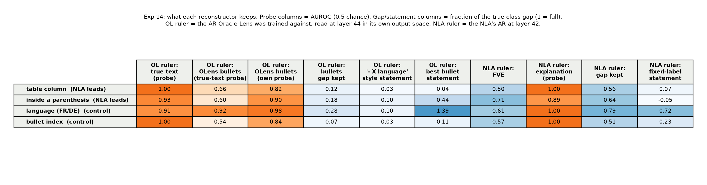

# Exp 14: is the Oracle Lens ruler blind to the concepts OLens misses?

**Status: done, 23 Oct 2026.** Headline: `results/headline.png` / `headline.md`; everything: `results/summary.md`; per-row JSON: `results/analysis14_*.json`.

## Question

Neel (23 Oct call): OLens is trained to invert an activation reconstructor (AR) that maps a short
text span to the activation it produces, so OLens is only ever rewarded for saying what the AR can
turn back into activation. "If you show that the AR is just terrible at dealing with that concept,
that would be pretty interesting. You could also just directly study what is in the error of the AR."

## Design

Rows: table column and inside-a-parenthesis (NLA leads OLens, length-controlled, exp 13) plus two
positive controls OLens reads well (language FR/DE, bullet index; exp 07). All 200 items per row
(mining + selection), activations captured at 40/42/44 in exps 07/13.

Rulers: the OLens AR `agu18dec/olens_and_ar:ar_ptag_pooled` (tags 20..60 step 4 and 63; no 42, so
tags 44 and 40 against the activations captured at 44 and 40) and the NLA's AR at 42.

Inputs to the OLens AR, per item: the true text (last 32 tokens, the AR's training crop; and last
128), fresh OLens bullets generated at the same layer (k=2), the fresh NLA explanation (k=2), and
the frozen statement pairs (OLens bullets and NLA sentences, fixed label + 3 mined). Inputs to the
NLA AR: the NLA explanation and the NLA statement pairs.

Measures per (ruler, layer, input): raw FVE and retrieval@1 (does the ruler reconstruct anything);
a probe fit on the true activations (grouped 5-fold) applied frozen to the reconstruction and to the
error term true - recon (what the ruler keeps vs drops); a probe retrained on the reconstruction (is
the concept linearly present at all); class-mean gap retained along the true direction; and for the
statement pairs, how far AR(A) - AR(B) moves along the true A-B direction as a fraction of the true gap.

Loader note (what `r5` established on true 32-token spans, table-column items, 23 Oct):
- the shipped LoRA is live (31% relative change of the read hidden state with the adapter on);
- the tags decode to `[Layer NN]`; the head reads target layer li at backbone block
  `layer_indices[li]` (blocks 5..16 for layers 20..63), not the final block;
- **the head's output is in the AR's whitened space**, not raw activation space: against raw
  activations retrieval@1 is 0.07 (chance 0.005) and FVE is negative for every read point and norm;
  against per-dimension standardised activations retrieval@1 is 0.38-0.44, and a ridge map fit on
  100 items recovers 0.43 held-out. The whitening moments (`whitening_iolens_pooled_L{40,44}`) are in
  the gated dataset `agu18dec/local-workspace`, which our token cannot read (access requested from the
  owner). Until then the OLens-AR side of the analysis is done **inside the AR's output space**: the
  reference is the AR's output on the true text; a probe fit there tells whether the ruler can carry
  the concept at all, and that probe applied to the outputs for OLens bullets / NLA explanations tells
  whether those texts convey it. The error-term analysis (true - recon in raw space) needs the moments
  and is deferred. The NLA-AR side is in raw space as designed.

## Readings

| true span through OL-AR | OLens bullets through OL-AR | reading |
|---|---|---|
| concept lost | lost | the ruler is blind; Neel's story holds; concept shows up in the error term |
| kept | lost | ruler fine, OLens is the weak link |
| kept | kept | neither is blind; the prompted gap is elsewhere (swap experiment next) |

Controls (language, bullet index) must come out kept/kept.

## Results

Probe columns are AUROC (0.5 chance), grouped 5-fold by item cluster. "Gap kept" and statement
columns are the class-mean difference of the reconstruction projected on the true class-mean
direction, as a fraction of the true gap (1 = the ruler moves the full real distance). OL ruler at
layer 44 (layer 40 is the same picture, `summary.md`); NLA ruler at 42.

| concept | OL ruler: true text (probe) | OL ruler: OLens bullets, true-text probe / own probe / gap | OL ruler: statement '- X language' style / best bullet statement | NLA ruler: FVE / probe / gap | NLA ruler: fixed statement |
|---|---|---|---|---|---|
| table column | 1.00 | 0.66 / 0.82 / 0.12 | 0.03 / 0.04 | 0.50 / 1.00 / 0.56 | 0.07 |
| inside a parenthesis | 0.93 | 0.60 / 0.90 / 0.18 | 0.10 / 0.44 | 0.71 / 0.89 / 0.64 | -0.05 |
| language (FR/DE), control | 0.91 | 0.92 / 0.98 / 0.28 | 0.10 / 1.39 | 0.61 / 1.00 / 0.79 | 0.72 |
| bullet index, control | 1.00 | 0.54 / 0.84 / 0.07 | 0.03 / 0.11 | 0.57 / 1.00 / 0.51 | 0.23 |

1. **The OLens ruler is not blind to the concepts OLens misses.** Given the true text (32 tokens),
   its output separates first vs fifth cell at 1.00 and inside vs outside parenthesis at 0.93, the
   same as the controls. The simplest version of the hypothesis ("the AR is terrible at that
   concept") is not supported.
2. **It is blind to descriptions of concepts, all concepts.** A bullet saying `- French language`
   vs `- German language` moves its output 0.10 of the real gap; a bullet written in French vs
   German (`- Je recommande` vs `- Je empfehle`) moves it 1.39. For table column, `- column one`
   vs `- column five` moves it 0.03, and no bullet statement does better than 0.04. For parenthesis
   the only statement that moves it is the mined continuation `- /or` vs `- /early` (0.44); the
   punctuation-bearing `- ), and` vs `- and` gives -0.17 and `- )` vs `- ,` 0.14, and the
   descriptive `- inside parentheses` vs `- outside parentheses` gives 0.10. The ruler maps text to
   activation by what the text *exhibits*, not by what it *says*.
3. **This is why OLens's channel for structure is a continuation.** OLens is rewarded only for text
   the ruler maps back. Language can be exhibited in two words; position in a table row can only be
   exhibited by reproducing a table row cut at the right cell, which OLens does (its bullets for a
   first-cell item are `- an | marocain | 45 | Linguistics | ...`). Those bullets carry the concept
   partially: 0.66 on the true-text probe and 0.82 with their own probe for table column, 0.60/0.90
   for parenthesis, against 0.92/0.98 for language. It is consistent with exp 12 (OLens states
   1 of 6,720 readouts (exps 12 and 13 at layer 42), exhibits language 56% and code 93%) and with exp 08/09 (OLens's
   newline-continuation tracks line position while every descriptive template is flat).
4. **The NLA ruler does respond to descriptions, but only of the control.** "The text is in French"
   vs "German" moves it 0.72 of the gap; "first column" vs "fifth column" 0.07, parenthesis -0.05,
   bullet index 0.23. The NLA's full explanations nevertheless reconstruct every concept (probe
   0.89-1.00, 51-79% of the gap kept, FVE 0.50-0.71), partly because they quote the text. So the
   NLA's lead on table column and parenthesis in the prompted table is not explained by its ruler
   understanding "fifth column" either; it is explained by the NLA's reader being asked in sentence
   register while OLens's reward never paid for sentences.
5. **Bullet index behaves like the structural rows, not like language**, although OLens reads it
   at 0.99 when prompted with `- item two` vs `- item nine`. Prompted reading and training reward
   are different channels: the base model plus LoRA can score a label it was never rewarded to write.

Caveats: the OL-ruler side is in the ruler's whitened output space (the moments are gated; see the
loader note), so "gap kept" there is relative to the ruler's own output on the true text, and the
error-term analysis Neel also suggested is deferred until the moments are available. Two fresh
readouts per item per reader (k=2), 200 items per row. Statement cosines are low (0.1-0.2) even
where the ratio is large: statements move the ruler mostly off the concept direction.

## For Neel

The ruler is not blind to table column or parenthesis: from the true text it reconstructs both. It
is blind to any *statement* of a concept, including "French language" (0.10 of the gap) while a
French bullet moves it the full gap. So OLens is rewarded for exhibiting, never for stating, and
position-in-structure can only be exhibited by reproducing the structure, which a short bullet does
partially (0.66 vs 0.92 for language). That is the mechanism behind "OLens states nothing" and
behind the NLA lead on position-in-text position. The error-term study needs the AR whitening moments
from `agu18dec/local-workspace` (gated).

## Cost

Modal, app `kq2`: four H100 readout rows (~50 min), four H200 NLA rows (~22 min), six H100
reconstruction/diagnostic runs (~20 min), CPU analysis. About $8. No judge calls.
